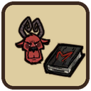

# DST Codex Umbra for Wortox



[English](#english) · [Português](#português)

## English

A Don't Starve Together mod that teaches Wortox Maxwell's shadow magic.

### Codex Umbra

- Wortox crafts the Codex Umbra from Maxwell's shadow tab (2 papyrus, 2 nightmare fuel, 50 health).
- The Codex summons shadow workers and protectors and casts the shadow trap and pillars, spending nightmare fuel as it does for Maxwell.
- Each minion lowers Wortox's max sanity like Maxwell's (15% per worker, 90% cap).
- Minions vanish when Wortox dies, becomes a ghost, swaps character or travels between the surface and the caves.
- Minions are translucent silhouettes like Maxwell's shadows, copying Wortox's skin (including wardrobe changes), which shows in the silhouette's shape. Tools and swords are part of the same silhouette.
- The colour follows Wortox's skill tree. His lean sets the base: Neutral is crimson, Nice a pinkish red, Naughty a dark blood red toward Maxwell's black. His allegiance tints it: Shadow darkens everything toward wine and violet (Naughty is the darkest), Lunar turns the shadow cyan and glowing, like a gestalt. Shadows already out recolour as soon as his skills change.

  | Lean / Allegiance | None | Lunar | Shadow |
  |---|---|---|---|
  | Nice | Rose `#FF6F91` | Moonbeam `#7FE8FF` | Dusk Rose `#A0206A` |
  | Neutral | Crimson `#DC143C` (default) | Gestalt `#2FD0F0` | Wine `#7A0A3A` |
  | Naughty | Blood `#8A0A22` | Deep Moon `#2A9ED4` | Void Red `#4E0418` |

- Shadows keep a little light of their own to stay visible at night, Lunar most of all.
- Opacity depends on the allegiance: 65% with none, 75% for Shadow, 50% for Lunar. The red shadows stay clearly darker than the ground, so their edges read sharply; Lunar keeps a gestalt's translucency.
- The despawn smoke and splat take the minion's colour. Maxwell's minions stay black.
- Wortox's minions can be examined: the owner has one line, another Wortox another, Maxwell his own, and everyone else a generic one. Maxwell's shadows stay unexaminable, as in the base game.
- Wortox has his own lines for the Codex.

### Panflute Troupe

- When Wortox plays the panflute while carrying the Codex Umbra (inventory, cursor or backpack), three shadow dancers appear around him with his skin and skill tree colour.
- They dance for about 10 seconds and vanish in smoke of the same colour. Playing again replaces the troupe instead of stacking dancers.
- They are purely visual: not minions, no sanity cost, never saved, and the flute does not put them to sleep.
- It has its own option. With the Codex Umbra option off Wortox cannot craft the book, but a Maxwell Codex he carries still calls the troupe.

### Languages

The mod list text and Wortox's lines are in English and Portuguese (Brazil); any other language uses English.

- The mod list text follows each player's own game language.
- Wortox's lines are resolved on the server, so everyone hears the same language. The `Language` option picks it: `Auto` (default) uses the server's language, or force `English` or `Português`.
- A world hosted from the game menu takes the host's game language each time it starts (`cluster_language` in `cluster.ini`). A standalone dedicated server sets `cluster_language` by hand.

### Local install

1. Close Don't Starve Together.
2. Copy `modinfo.lua`, `modmain.lua`, `modicon.tex`, `modicon.xml` and the `wortox_shenanigans_*.lua` files to `mods/wortox_shenanigans` in the game folder. The default Steam path on Linux is `~/.local/share/Steam/steamapps/common/Don't Starve Together/mods/wortox_shenanigans`.
3. Enable the mod for the server and pick the `Codex Umbra`, `Panflute Troupe` and `Language` options.
4. Restart the server after changing options or mod files.

### Notes

- The quick puff when a minion appears without its animation and the puff on skin changes stay black: their visuals only exist on clients, out of the mod's reach.
- The mod adds the `shadowmagic` tag, which also shows Maxwell's shadow crafting tab. The magician top hat and chest recipes appear, but Wortox lacks the magician ability, so the top hat works as a plain hat.

## Português

Mod para Don't Starve Together que ensina ao Wortox a magia de sombra do Maxwell.

### Codex Umbra

- O Wortox cria o Codex Umbra pela aba de sombra do Maxwell (2 papiros, 2 combustíveis do pesadelo, 50 de vida).
- O Codex invoca trabalhadores e protetores de sombra e lança a armadilha e os pilares de sombra, gastando combustível do pesadelo como no Maxwell.
- Cada lacaio reduz a sanidade máxima do Wortox como no Maxwell (15% por trabalhador, limite de 90%).
- Os lacaios somem quando o Wortox morre, vira fantasma, troca de personagem ou viaja entre a superfície e as cavernas.
- Os lacaios são silhuetas translúcidas, como as sombras do Maxwell, e copiam a skin do Wortox (inclusive ao trocar de skin no armário), que aparece no formato da silhueta. Ferramentas e espadas fazem parte da mesma silhueta.
- A cor segue a árvore de habilidades do Wortox. A inclinação define a base: Neutro é carmesim, Bonzinho é rosado, Travesso é um vermelho sangue escuro puxando para o preto do Maxwell. A aliança tinge a base: Sombra escurece tudo puxando para vinho e violeta (Travesso fica a cor mais escura) e Lunar deixa a sombra ciano e brilhante, como um gestalt. As sombras que já estão fora mudam de cor assim que as habilidades mudam.

  | Inclinação / Aliança | Nenhuma | Lunar | Sombra |
  |---|---|---|---|
  | Bonzinho | Rose `#FF6F91` | Moonbeam `#7FE8FF` | Dusk Rose `#A0206A` |
  | Neutro | Crimson `#DC143C` (padrão) | Gestalt `#2FD0F0` | Wine `#7A0A3A` |
  | Travesso | Blood `#8A0A22` | Deep Moon `#2A9ED4` | Void Red `#4E0418` |

- As sombras guardam um pouco de luz própria para continuar visíveis à noite, mais ainda na Lunar.
- A opacidade depende da aliança: 65% sem aliança, 75% na Sombra e 50% na Lunar. As sombras vermelhas ficam bem mais escuras que o chão, com bordas nítidas; a Lunar continua translúcida como um gestalt.
- A fumaça e a mancha que aparecem quando um lacaio some ficam da cor do lacaio. Os lacaios do Maxwell continuam pretos.
- Os lacaios do Wortox podem ser examinados: o dono tem uma fala, outro Wortox outra, o Maxwell uma própria e os demais personagens uma fala genérica. As sombras do Maxwell continuam sem exame, como no jogo base.
- O Wortox tem falas próprias para o Codex.

### Trupe da Flauta

- Quando o Wortox toca a flauta de pã carregando o Codex Umbra (no inventário, no cursor ou na mochila), três sombras dançarinas aparecem ao redor dele, com a skin e a cor da árvore de habilidades dele.
- Elas dançam por cerca de 10 segundos e somem numa fumaça da mesma cor. Tocar de novo troca a trupe em vez de acumular dançarinos.
- São só visuais: não contam como lacaios, não custam sanidade, não são salvas e não dormem com a música.
- Tem opção própria. Com a opção Codex Umbra desativada o Wortox não cria o livro, mas um Codex do Maxwell carregado por ele ainda chama a trupe.

### Idiomas

O texto da lista de mods e as falas do Wortox estão em inglês e português (Brasil); outros idiomas usam inglês.

- O texto da lista de mods segue o idioma do jogo de cada jogador.
- As falas do Wortox são resolvidas no servidor, então todos ouvem o mesmo idioma. A opção `Idioma` escolhe qual: `Automático` (padrão) usa o idioma do servidor, ou force `English` ou `Português`.
- Um mundo hospedado pelo menu do jogo pega o idioma do jogo de quem hospeda toda vez que inicia (`cluster_language` no `cluster.ini`). Um servidor dedicado avulso define `cluster_language` à mão.

### Instalação local

1. Feche o Don't Starve Together.
2. Copie `modinfo.lua`, `modmain.lua`, `modicon.tex`, `modicon.xml` e os arquivos `wortox_shenanigans_*.lua` para `mods/wortox_shenanigans` na instalação do jogo. O caminho Steam padrão no Linux é `~/.local/share/Steam/steamapps/common/Don't Starve Together/mods/wortox_shenanigans`.
3. Ative o mod para o servidor e escolha as opções `Codex Umbra`, `Trupe da Flauta` e `Idioma`.
4. Reinicie o servidor depois de alterar opções ou arquivos do mod.

### Notas

- A fumaça rápida quando um lacaio aparece sem animação e a fumaça ao trocar de skin continuam pretas: o visual delas só existe nos clientes e o mod não consegue tingi-las.
- O mod adiciona a tag `shadowmagic`, que também mostra a aba de criação de sombra do Maxwell. As receitas do chapéu e do baú de mágico aparecem, mas o Wortox não tem a habilidade de mágico, então o chapéu funciona como um chapéu comum.

## Tests / Testes

Requires Lua 5.1. / Requer Lua 5.1.

```bash
lua5.1 test/test_mod.lua
luac5.1 -p modinfo.lua modmain.lua wortox_shenanigans_tint.lua wortox_shenanigans_codex.lua wortox_shenanigans_panflute.lua test/test_mod.lua
```

## Credits / Créditos

Don't Starve Together, Wortox, Maxwell and the Codex Umbra belong to Klei Entertainment. The mod icon is assembled from game art (Wortox's avatar and the Codex Umbra inventory icon). This is an unofficial fan mod, not made or endorsed by Klei.

Don't Starve Together, Wortox, Maxwell e o Codex Umbra pertencem à Klei Entertainment. O ícone do mod foi montado com arte do jogo (o avatar do Wortox e o ícone do Codex Umbra). Este é um mod de fã não oficial, sem vínculo com a Klei.
